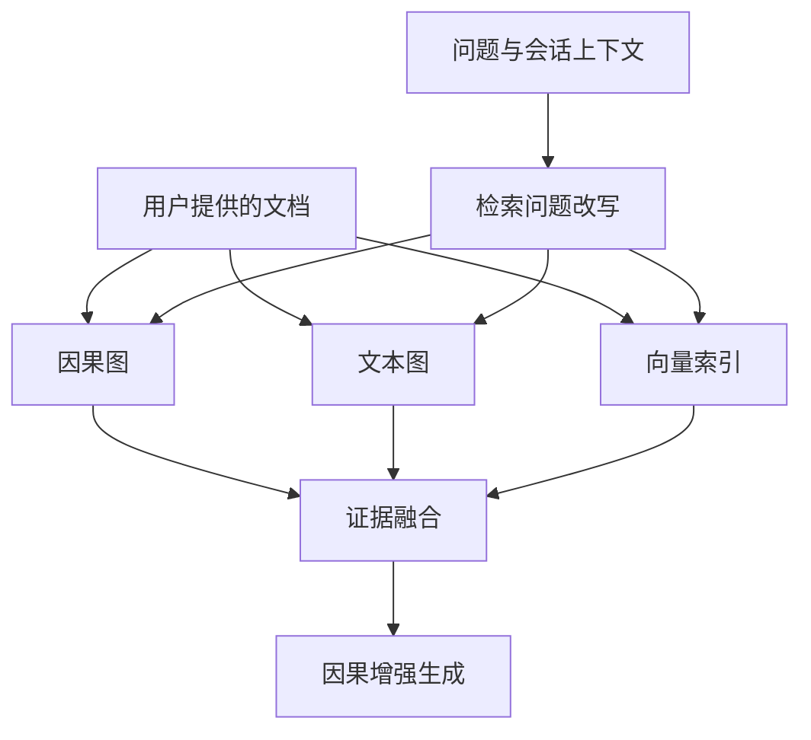

# Causal-Augmented-RAG

面向中文问答的因果增强检索与生成系统。在向量检索基础上引入文本图和因果图，支持分层检索、因果推理增强、多轮问答及多方法评测。

## 仓库与发布范围

本项目采用[双仓库维护方式](REPOSITORIES.md)：私有仓库保留完整开发资料，公开仓库仅包含经过审核的文件子集。公开版使用独立 Git 历史，不附带数据库、个人数据、原始语料、过程 JSON、协作记录或论文材料。

可公开的历史评测指标见 [evaluation_results/README.md](evaluation_results/README.md)。原始逐题结果和过程文件不随公开版分发。

## 功能

- 三层检索：L1 因果图命中、L2 文本图路径发现与因果鉴别、L3 向量检索兜底。
- 因果关系抽取、实体归一化、图谱清洗及可选动态因果回写。
- 多轮会话、检索问题改写及独立的学生状态数据处理模块。
- Full-Causal、Vector-Only、No-RAG 对比，以及 BM25 等评测基线。
- Streamlit 界面、命令行入口、EM/F1 与 LLM-as-judge 评测。



## 环境与运行

使用 Python 3.10 或以上版本，在自行准备的 Python 环境中安装依赖：

```bash
pip install -r requirements.txt
```

根据使用的服务设置环境变量。默认生成服务使用 `DEEPSEEK_API_KEY`，embedding 与 rerank 使用 `SILICON_API_KEY`。可选服务使用 `OPENROUTER_API_KEY`（兼容 `openrouter_api_key`）、`GEMINI_API_KEY` 或 `GEMINI_PAID_API_KEY`（兼容 `GEMINI_API_KEY_PAID`）。模型和参数见 `config/settings.py`。

PowerShell 示例：

```powershell
$env:DEEPSEEK_API_KEY="your_key"
$env:SILICON_API_KEY="your_key"
streamlit run app.py
```

请自行导入有权使用的文档。数据库、索引和图谱由程序运行时在 `data/` 下创建，公开仓库不包含预构建知识库。评测页面需要自行提供符合程序格式的测试集；历史私有测试资料不随源码分发。

命令行示例：

```bash
python main.py --kb-id demo_kb build --docs ./data/documents
python main.py --kb-id demo_kb ask "问题文本"
python main.py --kb-id demo_kb chat
python main.py --kb-id demo_kb eval --dataset ./data/datasets/qa.jsonl --output ./data/eval_results.jsonl
```

L2 回写默认可在内存中进行；需要持久化时使用 `--persist-causal-updates`。导入材料和运行问答会调用所配置的外部模型服务。

## 代码结构

| 路径 | 职责 |
| --- | --- |
| `app.py`、`main.py` | Web 与 CLI 入口 |
| `config/` | 模型、检索与图参数 |
| `knowledge_base/` | 文档处理、向量索引、文本图和因果图 |
| `retrieval/`、`generation/` | 分层检索、身份上下文与答案生成 |
| `services/`、`db/` | 流程服务和持久化逻辑 |
| `ui/` | 页面与评测交互 |
| `evaluation/evaluator.py` | 通用评测 |
| `evaluation_VS_hopRAG/` | 对齐评测的知识库构建与指标代码 |
| `evaluation_results/` | 经审核的汇总指标和口径说明 |

后端集成入口为 `knowledge_base.kb_manager.KBManager`，提供材料导入、检索、生成和问答接口。
